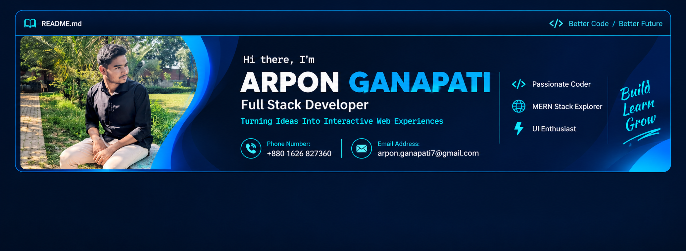

<!-- PROFILE BANNER -->

  

 

# 👋 Hey there, I'm Arpon Ganapati!

### 💻 Frontend Developer | Full-Stack Developer in Progress | Tech Enthusiast

  

  

  
  
  

---

## 👨‍💻 About Me

Hey! I'm **Arpon Ganapati**, a passionate web developer from **Bangladesh** who loves building modern, interactive, and user-friendly digital experiences.

I'm primarily focused on frontend development with React, while continuously expanding my knowledge of backend technologies and full-stack development.

My journey started with the fundamentals of programming and gradually evolved into building real-world applications, deploying websites, working with databases, and connecting frontend applications with backend services.

I enjoy solving problems, exploring new technologies, experimenting with creative ideas, and turning concepts into functional projects.

### 🎯 Quick Overview

| Category | Details |
|---|---|
| 👤 Name | Arpon Ganapati |
| 📍 Location | Bangladesh 🇧🇩 |
| 💻 Primary Focus | Frontend & Full-Stack Web Development |
| ⚛️ Frontend | React.js, JavaScript, TypeScript |
| 🛠️ Backend | Node.js, Express.js |
| 🗄️ Database | MongoDB |
| 🔥 Authentication | Firebase |
| 🐍 Programming | JavaScript, Python Fundamentals |
| 🚀 Deployment | Vercel, Netlify, Render |
| 🌱 Currently Learning | TypeScript, Backend Development & Full-Stack Architecture |
| 🎯 Goal | Become a skilled Full-Stack Developer |

> "Building, learning, experimenting, and improving — one project at a time. 🚀"

---

## 🛠️ Technical Arsenal

### 🎨 Frontend Development

  

- HTML5 & CSS3
- JavaScript (ES6+)
- JSX
- React.js
- Vite
- Tailwind CSS
- Responsive Web Design
- Component-Based Architecture

### ⚙️ Backend Development

  

- Node.js
- Express.js
- REST API Development
- Server-side Fundamentals
- Nodemailer
- Environment Variables
- Backend Integration

### 🗄️ Database & Authentication

  

- MongoDB
- MongoDB Atlas
- Firebase Authentication
- Firebase Admin SDK

### 📘 Programming & Learning

  

- TypeScript
- Python Fundamentals
- Problem Solving
- Programming Logic
- JavaScript Algorithms

### 🔧 Development Tools & Deployment

  

- Git & GitHub
- Visual Studio Code
- npm
- Postman
- Vercel
- Netlify
- Render
- Browser Developer Tools

---

## 🚀 Featured Projects

Here are some of the projects I've worked on during my development journey.

### 1. 🌐 Arpon Portfolio

**My personal developer portfolio.**

A React-based portfolio website showcasing my skills, projects, and development journey, with a functional contact system connected to a backend.

**Tech Stack:**
- React.js
- Vite
- Tailwind CSS
- Node.js
- Express.js
- Nodemailer

**Highlights:**
- Modern responsive interface
- Reusable React components
- Functional contact form
- Express backend integration
- Email delivery using Nodemailer

🔗 **Live Website:** https://arpon-web.vercel.app/

---

### 2. 📦 Fast-Shift

**Full-Stack Parcel Delivery & Rider Management Platform**

A parcel delivery platform designed to connect customers, delivery riders, and administrators through a unified application.

**Tech Stack:**
- React 19
- Vite
- Node.js
- Express.js
- MongoDB Atlas
- Firebase Authentication
- React Router
- React Query
- Tailwind CSS
- DaisyUI

**Highlights:**
- User authentication
- Parcel management workflows
- Rider management
- MongoDB database integration
- Backend API development
- Full-stack application architecture

🔗 **Live Website:** https://fast-shift.vercel.app/

🔗 **GitHub Repository:** https://github.com/arponganapati7-byte/Fast-Shift

---

### 3. 🌍 World on the GO

**An interactive country exploration application.**

A React and TypeScript project that allows users to explore countries and manage their visited destinations.

**Tech Stack:**
- React.js
- TypeScript
- Vite
- Tailwind CSS
- REST API
- React Router

**Highlights:**
- Country data integration
- Visited country management
- Country flags
- Persistent user selections
- Interactive UI

🔗 **Live Website:** https://6ab9c3777d349fa033e145ea--onthegoworld.netlify.app/

🔗 **GitHub Repository:** https://github.com/arponganapati7-byte/on-the-go-world-via-react

---

### 4. 🧩 Dev Stack Builder

**An interactive technology stack exploration project.**

A web-based project focused on presenting development technologies through an interactive and visually organized interface.

**Tech Stack:**
- HTML5
- CSS3
- JavaScript

**Highlights:**
- Interactive technology grid
- Organized technology categories
- Modern visual presentation

---

### 5. 📊 Sorting Visualizer

**Visualizing sorting algorithms through code.**

An interactive sorting visualization project that demonstrates how sorting algorithms work through animated elements.

**Tech Stack:**
- HTML
- CSS
- JavaScript
- React.js (React integration)

**Highlights:**
- Visual sorting demonstrations
- Dynamic element updates
- Interactive visualization
- React component development

---

### 6. 📋 FitLog

**A fitness tracking application project.**

A project through which I have been working with modern Next.js development and TypeScript.

**Tech Stack:**
- Next.js
- TypeScript
- React

---

### 7. 🧮 Python Calculator

**One of my programming fundamentals projects.**

A beginner Python project focused on developing programming logic and understanding control flow.

**Concepts Practiced:**
- Python fundamentals
- While loops
- Conditional statements
- Basic calculations

---

## 📊 GitHub Statistics

  
  

  

  

---

## 🌱 Currently Exploring

I'm continuously working to improve my development skills.

- 📘 TypeScript and advanced JavaScript
- ⚛️ Advanced React concepts
- 🛠️ Backend development with Node.js
- 🗄️ Database management with MongoDB
- 🔗 REST API architecture
- 🔐 Authentication and application security fundamentals
- 🚀 Full-Stack application development
- 🧠 Data structures and problem-solving

---

## 🏆 My Development Philosophy

- 💡 Learn by building real projects.
- 🔍 Understand the logic behind the code.
- 🧩 Break complex problems into smaller pieces.
- 🛠️ Focus on clean, maintainable code.
- 🚀 Build, test, debug, and improve.
- 📚 Never stop learning.

---

## 🤝 Let's Connect!

I'm always interested in connecting with fellow developers, exploring interesting technologies, and collaborating on creative projects.

  
  
  

---

  <b>⭐ If you find my projects interesting, feel free to explore my repositories!</b>

  

  <b>Made with ❤️ and lots of curiosity by Arpon Ganapati.</b>

